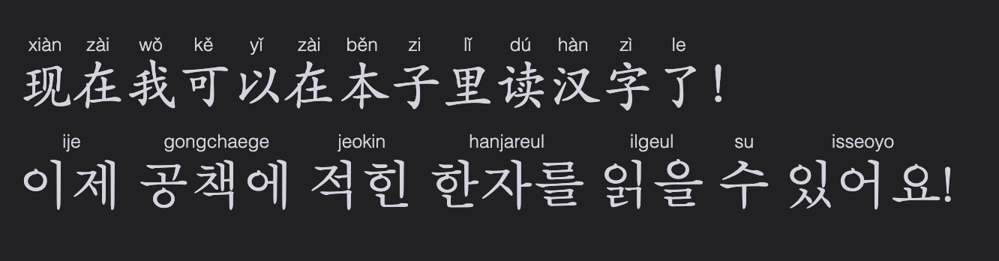

# Obsidian Big Characters

An Obsidian plugin for styling Chinese (Simplified and Traditional), Korean, and Japanese text, with optional automatic ruby pronunciation annotations.

Use `<span class="bc-zh-cn">...</span>` for Chinese characters without pinyin, such as a flashcard front side. This supports Simplified and Traditional Chinese.


For Korean characters use `<span class="bc-ko-kr">...</span>`.

When pinyin should be shown, use `<span class="bc-zh-cn-pinyin">...</span>`. Traditional Chinese uses Pinyin Pro’s Traditional dictionary for contextual pronunciation (for example, `轉盤` → `zhuàn pán`).

Korean characters with pronunciation use `<span class="bc-ko-kr-rom">...</span>`. Korean romanization follows pronunciation rules, so `같이` becomes `gachi` and `백마` becomes `baengma`.

Japanese has three modes:

- `<span class="bc-ja-jp">...</span>` styles text without pronunciation.
- `<span class="bc-ja-jp-romaji">...</span>` adds local Hepburn romaji above every Japanese token, including kana. For example, `座って` becomes `suwatte`.
- `<span class="bc-ja-jp-furigana">...</span>` adds hiragana only above kanji. In `食べる`, only `食` receives `た`; the okurigana remains ordinary text.

Japanese readings use the local IPADIC dictionary in `japanese-dictionary/`, separate from `main.js` so Obsidian does not read or parse dictionary data at startup. The dictionary is read only when a romaji or furigana marker is rendered, and makes no network requests.

To install manually, run `npm ci` and `npm run build`, then copy `main.js`, `manifest.json`, `styles.css`, `THIRD_PARTY_NOTICES.md`, and the entire `japanese-dictionary/` folder into your vault’s `.obsidian/plugins/big-characters/` folder. Keep the dictionary folder when copying or syncing the plugin to another device.



Fenced blocks work too: use `zh-cn` / `zh-cn-pinyin` for Chinese, `ko-kr` / `ko-kr-rom` for Korean, and `ja-jp` / `ja-jp-romaji` / `ja-jp-furigana` for Japanese.

````markdown
```zh-cn
你好，世界！
```

```zh-cn-pinyin
我喜欢学习中文。
```

```ko-kr
안녕하세요.
```

```ko-kr-rom
같이 먹어요.
```

```ja-jp
日本語を勉強します。
```

```ja-jp-romaji
座ってください。
```

```ja-jp-furigana
日本語を勉強します。
```
````

All markers support bold and italic text.


## Hotkeys

Assign shortcuts in Obsidian Settings → Hotkeys. 

Use `Big Characters: Toggle selection as ...` to add or remove plain markers. The corresponding pinyin, romanization, romaji, and furigana commands are separate hotkey entries.

## Settings

The plugin’s settings let you independently toggle pronunciations in Live Preview and Reading View for every annotated mode, and change the shared character and pronunciation size/font. Restore defaults if custom values go too far.

## Roadmap

- [x] Support Traditional Chinese
- [x] Support Korean
- [x] Support Japanese
  - [x] Support romaji
  - [x] Support furigana
- [ ] Support Cantonese

Third-party license notices are listed in [THIRD_PARTY_NOTICES.md](THIRD_PARTY_NOTICES.md).
