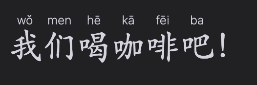
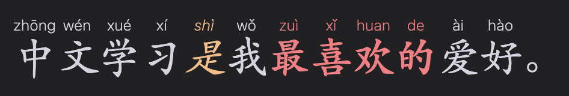

# Obsidian Big Characters

An Obsidian plugin for styling Chinese characters, with optional automatic ruby pinyin annotations.

Use `...` for Chinese characters without pinyin, such as a flashcard front side. 

Use `...` when pinyin should be shown according to the plugin’s Reading View and Live Preview settings. 

Both markers support bold and italic text.

## Hotkeys

Assign shortcuts in Obsidian Settings → Hotkeys. 

Use `Big Characters: Toggle selection as Chinese` to add or remove `bc-zh-cn`, or `Big Characters: Toggle selection as Chinese pinyin` for `bc-zh-cn-pinyin`.

## Settings

The plugin’s settings lets you independently toggle pinyin in Live Preview and Reading View for `bc-zh-cn-pinyin`, and change the character and pinyin size/font. Restore defaults if custom values went too off.

- [ ] Support Korean
- [ ] Support Japanese
  - [ ] Support Romanji
  - [ ] Support Furigana
- [ ] Support Traditional Chinese
- [ ] Support Cantonese
